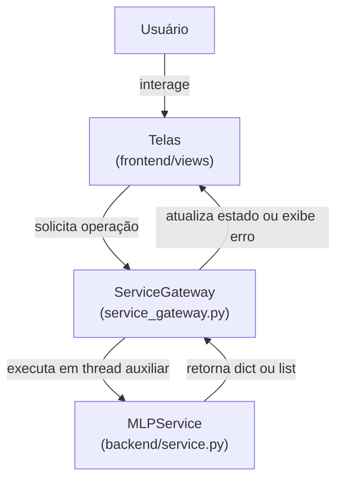

# Construtor de Redes Neurais MLP


O **Construtor de Redes Neurais MLP** é uma aplicação desktop para criar, treinar, avaliar e utilizar Redes Neurais Artificiais (RNA) do tipo *Multilayer Perceptron* (MLP) de forma interativa, sem necessidade de programar. A partir de um arquivo CSV, o usuário define quais colunas são entradas e quais são saídas desejadas, configura a topologia camada por camada (número de neurônios e função de ativação) e acompanha o aprendizado ao vivo observando a evolução do erro a cada época. O foco principal é a **regressão** (aproximação de valores contínuos, como preço de imóveis ou produtividade agrícola), oferecendo também **classificação** binária e multiclasse.

Toda a parte matemática foi implementada do zero em Python com NumPy, sem bibliotecas de aprendizado de máquina: neurônios, camadas densas, propagação direta (*forward pass*), retropropagação do erro (*backpropagation*) via regra da cadeia e otimização por Gradiente Descendente Estocástico (SGD). Essas operações ficam isoladas no backend e são expostas por uma fachada única, o `MLPService`, com a qual a interface gráfica (Flet) se comunica exclusivamente. Após o treinamento, o modelo pode ser persistido em JSON e carregado posteriormente para realizar inferências individuais ou em lote via CSV.

O projeto foi desenvolvido como trabalho avaliativo da disciplina **Inteligência Artificial** (Unijuí). A interface utiliza a paleta visual dos cursos de Ciência da Computação e Engenharia de Software, conta com temas claro e escuro e atende aos critérios de contraste WCAG AA.

---

## ✨ Principais Funcionalidades

Ao iniciar, a aplicação oferece dois fluxos de trabalho: **Criar novo modelo** ou **Usar modelo existente**.

### 🆕 Criar novo modelo

O fluxo é organizado em cinco etapas sequenciais (abas):

1. **Dados:** seleção da tarefa (regressão ou classificação), leitura de CSV, definição do papel de cada coluna (entrada, saída desejada ou ignorada), particionamento aleatório sem sobreposição em **treinamento, validação e teste** (com semente reprodutível) e pré-processamento por **Min-Max** ou **Z-Score** (ajustado exclusivamente no conjunto de treino). Colunas incompatíveis com a tarefa são sinalizadas imediatamente.
2. **Arquitetura:** detecção automática das dimensões de entrada e saída a partir do CSV (ou configuração manual), adição dinâmica de camadas ocultas com escolha de neurônios e função de ativação (`linear`, `sigmoid`, `tanh` ou `relu`), definição da ativação da camada de saída e semente dos pesos. Inclui sugestão heurística de neurônios ocultos ($2n + 1$, onde $n$ é o número de entradas) e visualização gráfica da topologia em tempo real.
3. **Treinamento:** configuração do número de épocas, taxa de aprendizagem ($\eta$) e semente de embaralhamento. Exibe ao vivo a curva do Erro Quadrático Médio (MSE) de treinamento e validação na escala original, permite interrupção cooperativa a qualquer momento, destaca a época de menor erro de validação e emite alertas diagnósticos em caso de sobreajuste (*overfitting*) ou divergência. O histórico pode ser exportado em CSV.
4. **Avaliação:** executa inferência nos três subconjuntos (treinamento, validação e teste). Na regressão, exibe MSE, coeficiente de determinação ($R^2$) e gráfico de valores desejados $\times$ estimados; na classificação, exibe MSE, acurácia e matriz de confusão.
5. **Previsão:** realiza predições para entradas digitadas manualmente (com opção de informar o valor desejado para comparação) ou para arquivos CSV em lote. Colunas marcadas como *Saída (oculta)* no CSV não são enviadas à rede, permitindo comparar lado a lado os valores reais e estimados com cálculo automático de métricas e exportação dos resultados.

A qualquer momento após a criação da rede, o modelo pode ser **salvo em JSON**. A opção **Usar modelo como base** carrega apenas a configuração estrutural de um modelo salvo (reiniciando os pesos), e **Reiniciar tudo** limpa o estado atual da sessão.

### 📂 Usar modelo existente

Carrega um arquivo JSON previamente treinado, apresenta o resumo de sua arquitetura, colunas esperadas e parâmetros de normalização, e habilita diretamente a aba de previsões manuais ou em lote.

### 🎨 Interface e acessibilidade

- Temas claro e escuro com contraste validado (WCAG AA).
- Feedbacks de erro, alerta e sucesso acompanhados de ícones e mensagens descritivas.
- Atalhos de teclado: `Ctrl+1` a `Ctrl+5` (navegação entre abas), `Ctrl+S` (salvar modelo), `Ctrl+O` (abrir modelo), `Ctrl+T` (alternar tema) e `Ctrl+M` (menu inicial).
- **Modo demonstração** com backend simulado (`MLP_FRONTEND_DEMO=1`) para testes isolados da interface.

---

## 🛠️ Tecnologias Utilizadas

| Tecnologia | Papel no projeto |
|---|---|
| **Python 3.10+** (testado no 3.14) | Linguagem base da aplicação |
| **NumPy** | Operações vetoriais/matriciais, normalização e métricas |
| **Flet 1.1.2** | Interface gráfica desktop multiplataforma |
| **flet-charts 1.1.2** | Gráficos de curva de aprendizagem e dispersão ($y \times \hat{y}$) |
| **pytest** | Suíte de testes automatizados (unitários, numéricos e integração) |

Da biblioteca padrão do Python são utilizados `csv`, `json`, `threading`, `asyncio` e `dataclasses`. Nenhuma biblioteca externa de *Machine Learning* (como TensorFlow, PyTorch ou scikit-learn) é empregada.

---

## 📁 Estrutura do Projeto

A organização abaixo reflete a árvore de diretórios do repositório:

```text
construtor_rna_mlp/
├── assets/                      # Capturas de tela, datasets, arquivos CSV e modelos JSON pré-treinados
├── backend/                     # Núcleo matemático, dados, treino e persistência
│   ├── data/
│   │   ├── __init__.py
│   │   ├── dataset.py           # Leitura de CSV, validação dimensional e split treino/val/teste
│   │   └── normalization.py     # Normalização e desnormalização Min-Max e Z-Score
│   ├── neural_network/
│   │   ├── __init__.py
│   │   ├── activations.py       # Funções linear, sigmoid, tanh e ReLU com derivadas analíticas
│   │   ├── initializers.py      # Inicialização He (ReLU) e Xavier/Glorot (demais ativações)
│   │   ├── layer.py             # Camada densa (agrupamento de neurônios e retenção de entradas)
│   │   ├── losses.py            # Erro Quadrático Médio (MSE)
│   │   ├── network.py           # Rede MLP: forward pass e backpropagation com SGD
│   │   └── neuron.py            # Neurônio artificial: z = w·x + b, saída a = f(z) e delta
│   ├── tests/                   # Testes unitários e verificação numérica de gradientes
│   ├── __init__.py
│   ├── classification.py        # Codificação binária/One-Hot, acurácia e matriz de confusão
│   ├── errors.py                # Exceções de domínio (Config, Dataset, State, Persistence)
│   ├── persistence.py           # Serialização e validação estrutural de modelos em JSON
│   ├── predictor.py             # Pipeline de inferência (normalização -> forward -> escala real)
│   ├── service.py               # MLPService: fachada única consumida pela interface
│   └── trainer.py               # Loop de treinamento SGD por épocas com parada cooperativa
├── frontend/                    # Interface gráfica desktop (Flet)
│   ├── components/              # Componentes visuais, gráficos e diagrama da topologia
│   ├── tests/                   # Testes de fluxo, contraste WCAG e integração com o backend
│   ├── views/                   # Telas das etapas (Dados, Arquitetura, Treino, Avaliação, Previsão)
│   ├── __init__.py
│   ├── __main__.py              # Suporte à execução via python -m frontend
│   ├── analysis.py              # Diagnóstico automático da curva (overfitting e divergência)
│   ├── app.py                   # Janela principal, roteamento, atalhos e barra de status
│   ├── batch_prediction.py      # Processamento de previsões em lote via CSV
│   ├── context.py               # Contexto e dependências injetadas nas views
│   ├── csv_utils.py             # Utilitários de leitura e exportação de CSV na UI
│   ├── demo_service.py          # Implementação simulada para o modo demonstração
│   ├── main.py                  # Ponto de entrada da aplicação desktop
│   ├── model_files.py           # Diálogos e validações de arquivos de modelo na UI
│   ├── parsing.py               # Conversão e validação de entradas textuais do usuário
│   ├── service_gateway.py       # Ponte assíncrona (asyncio.to_thread) com o MLPService
│   ├── state.py                 # Estado reativo compartilhado entre as abas
│   ├── texts.py                 # Textos, rótulos e mensagens da interface
│   └── theme.py                 # Paleta institucional (CC/ES) e temas claro/escuro
├── .gitignore                   # Arquivos e diretórios ignorados pelo Git
├── pytest.ini                   # Configuração do executor de testes
├── README.md                    # Documentação principal do projeto
└── requirements.txt             # Dependências Python do projeto
```

### 🔗 Comunicação entre frontend e backend

As telas (`frontend/views/`) nunca acessam o backend diretamente. Toda solicitação passa pelo `ServiceGateway`, que despacha a chamada em uma *thread* auxiliar (`asyncio.to_thread`) para o `MLPService` e devolve tipos nativos do Python (`dict`, `list`, `float`, `str`) ou exceções traduzidas em mensagens amigáveis.



### 🧩 Arquitetura modular do backend

O backend foi organizado em quatro camadas de responsabilidade desacopladas, todas coordenadas exclusivamente pela fachada `MLPService` (`backend/service.py`):

1. **Núcleo da Rede Neural (`backend/neural_network/`):**
   - `neuron.py` (`Neuron`): representa a unidade computacional elementar, armazenando seu vetor de pesos sinápticos $\mathbf{w}$, viés $b$, potencial de ativação ($z = \mathbf{w}^T\mathbf{x} + b$), saída ativada ($`a = f(z)`$) e gradiente local ($\delta = \partial E / \partial z$).
   - `activations.py` (`Activation`): registra as funções diferenciáveis (`linear`, `sigmoid`, `tanh` e `relu`) junto de suas derivadas analíticas $f'(z)$ otimizadas em termos da própria saída $a$, incluindo proteção numérica contra *overflow* na exponencial da sigmoide.
   - `initializers.py`: define as estratégias de inicialização de pesos **He Normal** (para `relu`) e **Xavier/Glorot Uniforme** (para as demais ativações), mantendo todos os vieses iniciados em zero.
   - `layer.py` (`Layer`): agrupa um conjunto de neurônios densamente conectados ao mesmo vetor de entrada e função de ativação, retendo o vetor de entrada do último passo (`last_inputs`) para o cálculo dos gradientes na retropropagação.
   - `network.py` (`NeuralNetwork`): encadeia dinamicamente as camadas, executa a propagação direta (`forward`), calcula os gradientes locais pela regra da cadeia (`backward`) e atualiza pesos e vieses via SGD.
   - `losses.py`: implementa a função de custo Erro Quadrático Médio (`mse` e `evaluate_mse`).

2. **Pipeline de Dados e Pré-processamento (`backend/data/`):**
   - `dataset.py`: lê cabeçalhos (`read_columns`) e carrega matrizes de atributos $\mathbf{X}$ e alvos $\mathbf{Y}$ a partir de arquivos CSV (`load_csv`), valida compatibilidade dimensional com a topologia da rede (`check_compatibility`) e realiza o particionamento aleatório sem sobreposição em subconjuntos de treinamento, validação e teste (`split`).
   - `normalization.py` (`Normalizer` e `apply_normalization`): aplica escalonamento **Min-Max** ou padronização **Z-Score** ajustando os parâmetros estatísticos **exclusivamente** sobre o conjunto de treinamento para impedir vazamento de dados (*data leakage*), além de prover `inverse_transform` para devolver saídas e métricas à escala física original.

3. **Motor de Treinamento e Inferência:**
   - `trainer.py` (`Trainer`): gerencia o loop de treinamento por épocas do SGD, embaralhando os índices das amostras de treino a cada época, computando o MSE de treino e validação já na escala original, notificando a interface via callback `on_epoch` e suportando interrupção cooperativa segura via `threading.Event`.
   - `predictor.py` (`predict`): encapsula o fluxo completo de inferência para novos padrões individuais — valida a finitude numérica das entradas, aplica o normalizador de entrada, executa `network.forward`, desnormaliza a saída e decodifica o rótulo textual quando a tarefa é classificação.

4. **Classificação, Persistência e Tratamento de Erros:**
   - `classification.py` (`LabelEncoder`, `accuracy`, `confusion_matrix`): converte rótulos textuais em codificação binária ($0/1$) ou *one-hot* (para 3 ou mais classes), realiza a decodificação inversa (limiar $0{,}5$ ou `argmax`) e calcula acurácia e matriz de confusão.
   - `persistence.py` (`save_model`, `load_model`): serializa a arquitetura completa, pesos, vieses, parâmetros dos normalizadores e metadados das colunas em JSON versionado, validando estrutura, dimensões e finitude numérica ao carregar.
   - `errors.py`: define a hierarquia `BackendError` (`ConfigError`, `DatasetError`, `StateError`, `PersistenceError`), convertendo falhas de regra de negócio em mensagens diagnósticas claras para o usuário.

---

## 💡 Decisões de Desenvolvimento

1. **MLP implementada do zero com NumPy:** toda a estrutura matemática (neurônio, camada, propagação direta, *backpropagation* e SGD) foi codificada sem frameworks de ML, mantendo correspondência direta com as equações teóricas da disciplina.
2. **Fachada única (`MLPService`):** isola completamente a lógica numérica da interface gráfica, retornando apenas estruturas nativas serializáveis e facilitando testes automatizados sem dependência de janela.
3. **SGD on-line (atualização exemplo a exemplo):** a cada época, os padrões de treinamento são embaralhados e os pesos são ajustados imediatamente após cada amostra com base no Erro Quadrático Médio (MSE).
4. **Inicialização adequada à ativação e reprodutibilidade:** camadas com `relu` utilizam inicialização He Normal ($`\mathcal{N}(0, \sqrt{2/n_{in}})`$); camadas com `linear`, `sigmoid` ou `tanh` utilizam Xavier/Glorot Uniforme ($\mathcal{U}[-\sqrt{6/(n_{in}+n_{out})}, +\sqrt{6/(n_{in}+n_{out})}]$). Todos os vieses iniciam em zero e um único gerador (`np.random.default_rng`) garante determinismo quando uma semente é informada.
5. **Prevenção de vazamento de dados (*data leakage*) e normalização das saídas:** os parâmetros de Min-Max e Z-Score são extraídos **exclusivamente** do subconjunto de treinamento e reaplicados na validação e no teste. Em regressão, as saídas também são normalizadas para evitar saturação em funções limitadas (`sigmoid`/`tanh`), sendo revertidas à escala física original antes do cálculo das métricas exibidas ao usuário.
6. **Execução assíncrona na interface:** o treinamento roda em *thread* dedicada com controle cooperativo de parada (`threading.Event`), mantendo a interface responsiva enquanto atualiza o gráfico de perda ao vivo.
7. **Particionamento disjunto sem perda de amostras:** o arredondamento percentual na divisão treino/validação/teste destina o excedente ao conjunto de teste e impede que qualquer subconjunto fique vazio.
8. **Suporte unificado a regressão e classificação:** problemas binários utilizam 1 neurônio de saída (limiar $0{,}5$); problemas multiclasse utilizam codificação *one-hot* com decisão por `argmax`.
9. **Persistência JSON versionada e validada:** salva topologia, pesos, vieses, normalizadores de entrada/saída e metadados das colunas, validando dimensões e finitude numérica na leitura.
10. **Verificação numérica de gradientes:** a suíte de testes valida o *backpropagation* comparando os gradientes analíticos com diferenças finitas e conferindo cálculos manuais no problema clássico XOR.

---

## ⚙️ Detalhes Técnicos do Backend

### 🎛️ Fachada `MLPService` (`backend/service.py`)

| Etapa | Método principal | Descrição |
|---|---|---|
| Arquitetura | `create_network(n_inputs, layers, seed, task)` | Constrói a topologia da rede e reinicia o estado da sessão |
| Dados | `load_dataset(path, input_cols, output_cols)` | Carrega o CSV, codifica classes (se aplicável) e valida dimensões |
| Pré-processamento | `split_dataset(...)` e `set_normalization(kind)` | Particiona os dados e ajusta Min-Max ou Z-Score apenas no treino |
| Treinamento | `start_training(epochs, lr, ...)` / `stop_training()` | Executa o SGD em segundo plano e emite métricas por época |
| Avaliação | `evaluate(subset)` | Calcula MSE e $R^2$ (regressão) ou acurácia e matriz de confusão |
| Previsão | `predict(values)` | Realiza inferência retornando os valores na escala original |
| Persistência | `save(path)` e `load(path)` | Grava e restaura o modelo completo em formato JSON |

Exemplo de uso direto do backend via script Python:

```python
import threading
from backend.service import MLPService

svc = MLPService()
svc.create_network(
    n_inputs=2,
    layers=[
        {"neurons": 4, "activation": "tanh"},    # camada oculta
        {"neurons": 1, "activation": "linear"},  # camada de saída
    ],
    seed=42,
    task="regression",
)
svc.load_dataset("dados.csv", input_cols=["sementes_m2", "nitrogenio_kg_ha"], output_cols=["produtividade_kg_ha"])
svc.split_dataset(70, 15, 15, seed=42)
svc.set_normalization("zscore")

done = threading.Event()
svc.start_training(epochs=300, lr=0.003, shuffle_seed=42, on_finish=done.set)
done.wait()

print(svc.evaluate("test"))   # {"subset": "test", "mse": ..., "r2": ..., ...}
print(svc.predict([250, 60])) # {"outputs": [...]}
svc.save("modelo.json")
```

### 🧠 Formulação Matemática e Backpropagation (`backend/neural_network/network.py`)

No código, utiliza-se $N$ para o total de amostras de um subconjunto e $N_{out}$ para o número de neurônios da camada de saída.

- **Erro Quadrático Médio (MSE) global (`losses.py`):** avaliado de forma generalizada sobre $N$ amostras e $N_{out}$ saídas (reduzindo-se à expressão clássica de saída única quando $N_{out} = 1$):

$$\text{MSE} = \frac{1}{N \cdot N_{out}} \sum_{n=1}^{N} \sum_{k=1}^{N_{out}} \left(y_{n,k} - \hat{y}_{n,k}\right)^2 \qquad \xrightarrow{N_{out} = 1} \qquad \text{MSE} = \frac{1}{N} \sum_{n=1}^{N} \left(y_n - \hat{y}_n\right)^2$$

- **Retropropagação do erro por padrão (`network.backward`):** para cada amostra $(\mathbf{x}, \mathbf{y})$ apresentada no SGD, com perda quadrática $E = \frac{1}{N_{out}}\sum_{k=1}^{N_{out}}(y_k - \hat{y}_k)^2$:

$$\text{Camada de saída } (L): \quad \delta_k^{(L)} = \frac{2}{N_{out}} \left(\hat{y}_k - y_k\right) f'\!\left(z_k^{(L)}\right)$$

$$\text{Camadas ocultas } (l): \quad \delta_j^{(l)} = \left(\sum_{k} w_{kj}^{(l+1)} \, \delta_k^{(l+1)}\right) f'\!\left(z_j^{(l)}\right) \quad \text{(usando os pesos antes da atualização)}$$

$$\text{Atualização SGD:} \quad w_{ji} \leftarrow w_{ji} - \eta \, \delta_j \, x_i, \qquad b_j \leftarrow b_j - \eta \, \delta_j$$

### 🏋️ Treinamento e Avaliação (`backend/trainer.py` e `backend/service.py`)

- **Loop de treinamento (`Trainer.run`):** a cada época, os índices do conjunto de treinamento são embaralhados com `np.random.default_rng(shuffle_seed)`. Para cada amostra, executa-se `forward` e `backward` sequencialmente. Ao final da época, calcula-se o MSE nos subconjuntos de treinamento e validação (revertendo a normalização de saída via `y_normalizer.inverse_transform`, quando ativa) e emite-se um `EpochResult` pelo callback `on_epoch`. A interrupção cooperativa verifica continuamente um `threading.Event`.
- **Avaliação (`MLPService.evaluate`):** executa inferência no subconjunto selecionado (`train`, `val` ou `test`), reverte a escala das saídas para o domínio físico original e calcula **MSE** e coeficiente de determinação **$R^2$** na regressão, ou **MSE**, **acurácia** e **matriz de confusão** na classificação.

### 💾 Persistência (`backend/persistence.py`)

Os modelos são salvos em JSON legível contendo versão de esquema, tarefa, dimensões, pesos/vieses por neurônio, parâmetros dos normalizadores e nomes das colunas:

```json
{
  "format_version": 1,
  "task": "regression",
  "n_inputs": 2,
  "layers": [
    {"n_neurons": 4, "activation": "tanh", "neurons": [{"weights": [1.23, 0.03], "bias": -0.81}]},
    {"n_neurons": 1, "activation": "linear", "neurons": [{"weights": [0.45, -0.12], "bias": 0.10}]}
  ],
  "normalization": {"kind": "zscore", "params": {"mean": [200.0, 50.0], "std": [40.0, 15.0]}},
  "y_normalization": {"kind": "zscore", "params": {"mean": [3500.0], "std": [420.0]}},
  "meta": {"input_cols": ["sementes_m2", "nitrogenio_kg_ha"], "output_cols": ["produtividade_kg_ha"]}
}
```

---

## 🚀 Instalação e Execução

### 📋 Pré-requisitos

- **Python 3.10 ou superior** instalado (no Windows, marque *Add python.exe to PATH* durante a instalação).
- **Conexão com a internet** na primeira execução para instalar as dependências e baixar o cliente desktop do Flet.

### 1️⃣ Baixar o projeto e preparar o ambiente virtual

Abra um terminal na pasta desejada e execute:

```bash
git clone https://github.com/LuanVitorCD/construtor_rna_mlp.git
cd construtor_rna_mlp
```

*(Caso tenha baixado o arquivo `.zip`, extraia-o e abra o terminal dentro da pasta `construtor_rna_mlp`.)*

Crie e ative o ambiente virtual isolado:

- **Windows (PowerShell):**
  ```powershell
  python -m venv .venv
  .venv\Scripts\Activate.ps1
  ```
- **Windows (Prompt de Comando / CMD):**
  ```bat
  python -m venv .venv
  .venv\Scripts\activate.bat
  ```
- **Linux / macOS:**
  ```bash
  python3 -m venv .venv
  source .venv/bin/activate
  ```

*(Quando ativo, o prefixo `(.venv)` aparecerá no início da linha do terminal.)*

### 2️⃣ Instalar dependências e abrir a aplicação

Com o ambiente virtual ativo, instale os pacotes e execute a interface:

```bash
pip install -r requirements.txt
python -m frontend
```

A janela principal será aberta no menu inicial. *(Alternativamente, também é possível iniciar via `python frontend/main.py` ou `flet run frontend/main.py`.)*

### 3️⃣ Roteiro rápido para testar a aplicação

1. **Datasets e modelos prontos:** a pasta `assets/` já contém datasets CSV e modelos JSON pré-treinados para testes imediatos, ou você pode usar qualquer CSV próprio com cabeçalho e ponto como separador decimal.
2. **Criar um modelo do zero:** clique em **Criar novo modelo**, carregue um CSV na aba **Dados** (recomendado ativar normalização **Z-Score** ou **Min-Max**), configure as camadas na aba **Arquitetura** e clique em **Criar rede**.
3. **Treinar e avaliar:** na aba **Treinamento**, defina épocas e taxa de aprendizagem ($\eta$) e clique em **Iniciar treinamento**. Em seguida, confira as métricas na aba **Avaliação**, teste novos valores na aba **Previsão** e salve o modelo com `Ctrl+S`.

### 🎭 Modo demonstração e suíte de testes

- **Modo demonstração (executa a UI com dados simulados):**
  - PowerShell: `$env:MLP_FRONTEND_DEMO = "1"; python -m frontend`
  - Linux / macOS: `MLP_FRONTEND_DEMO=1 python -m frontend`
- **Executar testes automatizados (sem abrir janela):**
  ```bash
  python -m pytest                # executa toda a suíte
  python -m pytest -m "not slow"  # ignora testes demorados de convergência
  ```

### 🩹 Solução rápida de problemas

- **Erro de execução de scripts no PowerShell:** execute `Set-ExecutionPolicy -Scope CurrentUser -ExecutionPolicy RemoteSigned` uma única vez ou utilize o Prompt de Comando (`cmd`).
- **`ModuleNotFoundError: No module named 'flet'`:** confirme que o ambiente virtual `(.venv)` está ativo antes de rodar `pip install -r requirements.txt`.
- **`No module named frontend`:** certifique-se de que o terminal está posicionado na pasta raiz do projeto (`construtor_rna_mlp/`).
